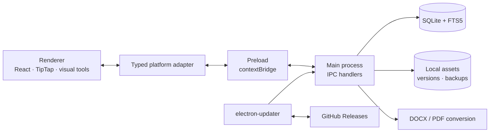

<h1 align="center">FanCreator</h1>

  <b>A desktop workspace for writing fiction and building story worlds</b> 
  Manuscripts, characters, linked notes and visual planning in one offline application.

  <b>English</b> · <a href="README.ru.md">Русский</a>

  
  
  
  
  

  <a href="https://github.com/nazar987/FanCreator-releases/releases/latest"><b>Download for Windows</b></a>

  

## Overview

FanCreator brings the manuscript and its supporting material into a single project.
Chapters, character dossiers, plot boards, timelines and family trees stay together,
with links between the text and the story world.

The Windows application works offline without an account. Project data and images
are stored locally; writing and editing do not depend on a server. Updates are
distributed through GitHub Releases. The application interface is in Russian.

Development is guided by feedback from a fiction author using the application
for everyday manuscript work.

## Features

| Area | Capabilities |
| --- | --- |
| **Manuscript editor** | A4 pagination, page breaks, fonts, paragraph styles, spacing, indents, tables, images and format painter |
| **Document exchange** | DOCX import and export; PDF export of individual chapters or a complete story |
| **Linked workspace** | Wiki-links to characters, stories and chapters, hover previews and inline sub-pages |
| **Visual planning** | Infinite boards with notes, images, shapes and adjustable arrows; timelines with sub-events and a fishbone view |
| **Story world** | Character dossiers, custom fields, reusable templates, galleries, hierarchy trees and family trees |
| **Navigation and search** | Workspace tabs, a command palette, SQLite FTS5 full-text search and project-wide find and replace with chapter previews |
| **Writing tools** | Russian and English spellcheck, word counts, daily goals and timed writing sprints |

  

### Data protection

- Automatic chapter history retains up to 20 versions per chapter. Restoring a version
  first saves a snapshot of the current text.
- Projects, stories and chapters go to a recoverable trash before permanent deletion.
- `.fancreator` backup archives include project data and images. Import assigns new
  identifiers to avoid overwriting an existing project.
- Optional backups run when the application exits. Pending edits are flushed before
  closing or installing an update.
- If storage cannot be opened safely, the application enters an explicit read-only mode.
  Mutations are blocked in both IPC handlers and storage functions; export to an external
  location remains available for accessible data.

### Themes

Eleven themes include six color palettes and five visual worlds: Fantasy, Dark Fantasy,
Medieval, Sci-Fi and Cyberpunk. The worlds change materials, typography, component geometry
and animation while keeping manuscript pages consistent. The theme system uses semantic
design tokens and procedural SVG textures, supports reduced motion, and offers a calmer
visual intensity.

  

## Architecture

FanCreator separates the React interface, the preload bridge and the Electron main process.
The renderer accesses desktop capabilities through a typed platform adapter; file access,
storage, document conversion and updates run in the main process.

### Engineering decisions

- **Typed process boundaries.** A shared API contract and channel registry connect main
  and preload. Channels are classified by their effects, allowing read-only restrictions
  to be applied centrally. Architecture tests check channel mappings and import boundaries.
  The renderer uses `contextIsolation: true` and `nodeIntegration: false`; project images
  are served through a custom `asset://` protocol.
- **Transactional local storage.** SQLite runs in WAL mode. Project writes and FTS5 index
  updates share a transaction, keeping searchable text consistent with saved content.
  Storage startup checks format compatibility before allowing writes.
- **A paginated web editor.** TipTap and ProseMirror are extended for manuscript-specific
  behavior, including paragraph indentation, image sizing, page breaks, internal links
  and keyboard handling.
- **Document conversion.** DOCX import parses OOXML formatting and embedded images,
  with a mammoth fallback. PDF export renders chapters in a hidden Electron window,
  waits for images to decode and uses `printToPDF` with A4 layout.
- **Recovery in the data layer.** Main-process handlers enforce snapshots before restore
  and bulk replacement. Content changes made outside the editor notify open chapters
  so a later autosave does not overwrite the updated text.

## Stack and verification

| Layer | Technologies |
| --- | --- |
| Desktop | Electron 34, electron-vite, electron-builder, Windows NSIS installer |
| Interface | React 18, TypeScript 5.7, Framer Motion, Lucide, @hello-pangea/dnd |
| Editor | TipTap 3, ProseMirror, tiptap-pagination-plus, custom extensions |
| Storage | better-sqlite3, SQLite WAL and FTS5, electron-store |
| Documents and backups | OOXML parser, mammoth, docx, html-to-docx, JSZip, Electron printToPDF |
| Verification | Vitest, happy-dom, TypeScript checks, architecture tests |
| Delivery | GitHub Actions, GitHub Releases, electron-updater |

Main-process tests execute real SQLite queries through a `node:sqlite` adapter for the
`better-sqlite3` API. Dedicated suites cover storage failures, read-only behavior,
backup and restore, document conversion, editor behavior and architecture boundaries.
CI runs type checks and automated tests before release packaging.

A version tag starts the Windows release pipeline: validate the version and release
destination, rebuild native dependencies for Electron, run checks, bundle the app and
publish the installer with its update manifest. Installed copies download updates in
the background and can apply them on exit or through the update action.

## Download and installation

1. Open the [latest release](https://github.com/nazar987/FanCreator-releases/releases/latest).
2. Download `FanCreator-Setup-x.y.z.exe` and run the installer.
3. Launch FanCreator and create a project.

The distributed build targets Windows 10/11, x64. The installer is currently unsigned,
so Windows SmartScreen may display a warning. Subsequent updates are handled by the application.

## Development direction

An Android companion is being explored through architecture work and isolated prototypes:
a shared TypeScript core, a Capacitor shell and synchronization between devices.
These capabilities are under development and are not part of the current Windows release.

## About this repository

This public repository contains the project overview, screenshots, installers and update
metadata. The application source is maintained in a private repository.

## License

© 2025–2026 nazar987. All rights reserved.

The official installer may be downloaded and used free of charge. Copying, redistributing,
modifying or presenting the application or its parts as your own work requires written
permission. Full terms: [LICENSE](https://github.com/nazar987/FanCreator-releases/blob/main/LICENSE).
