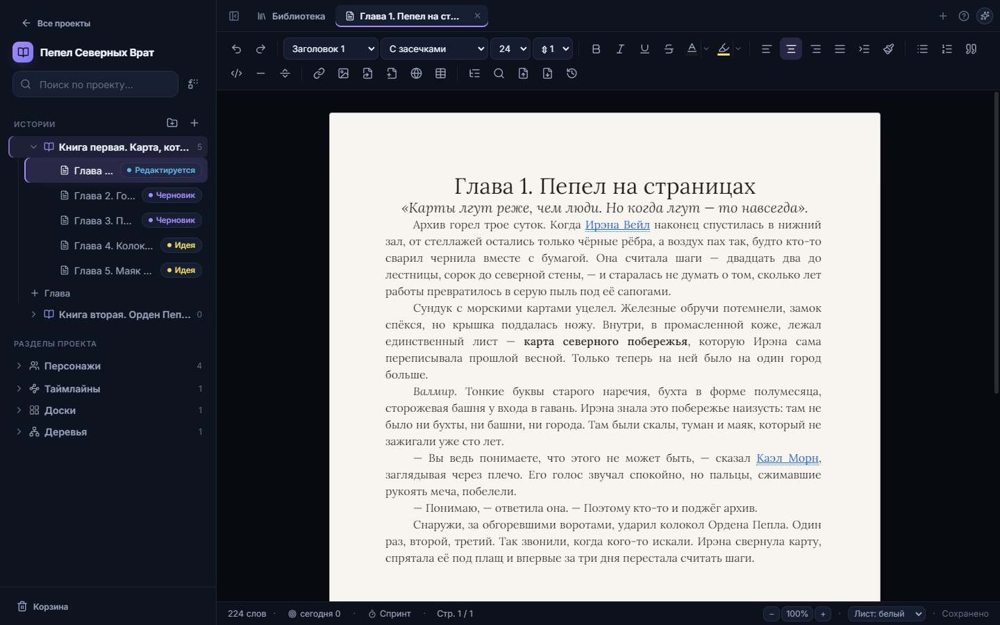
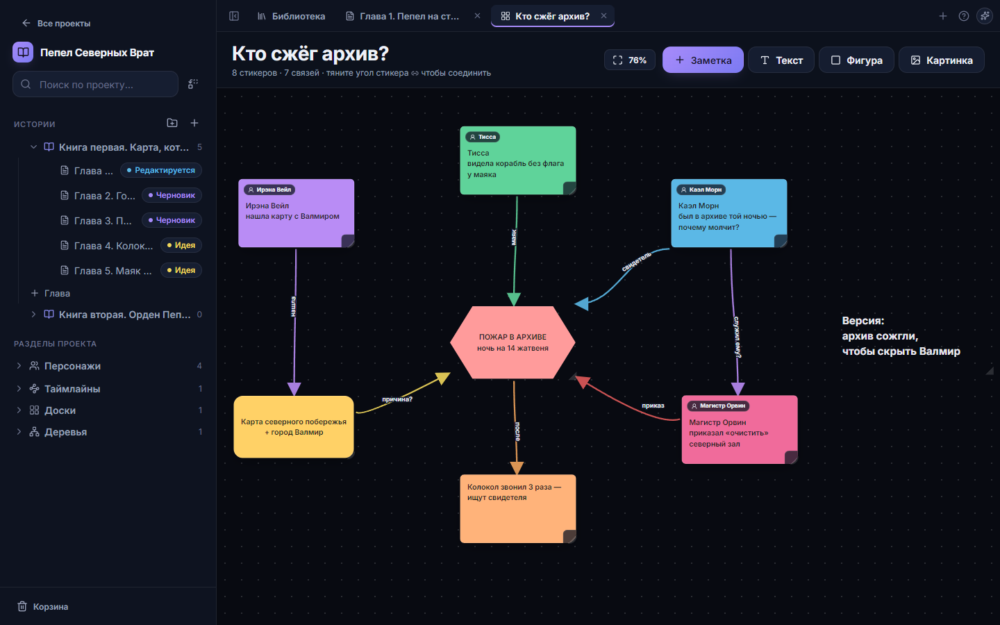
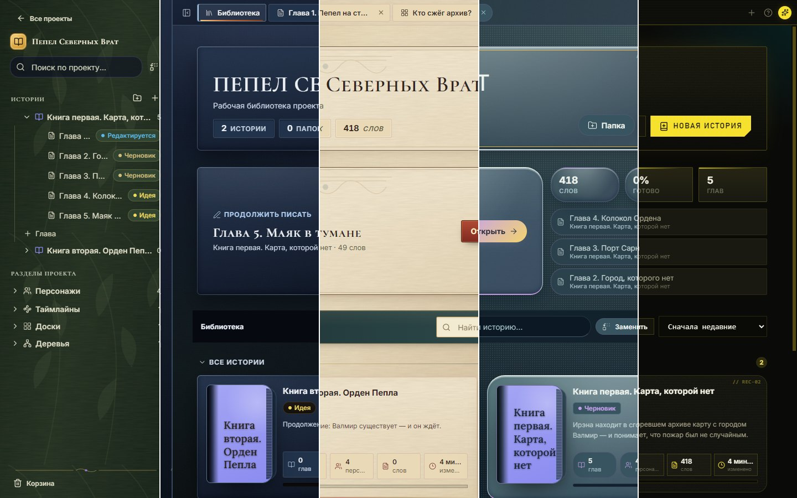
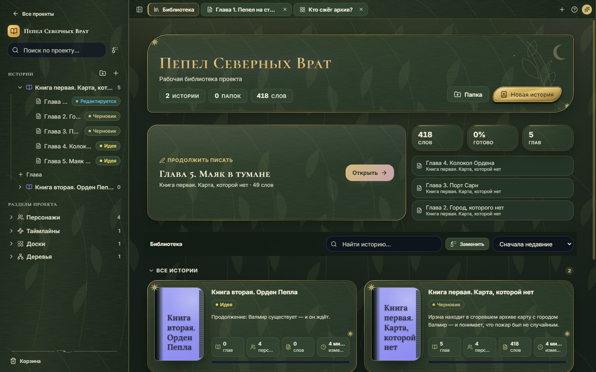
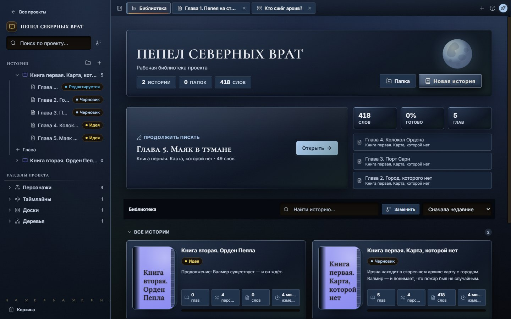
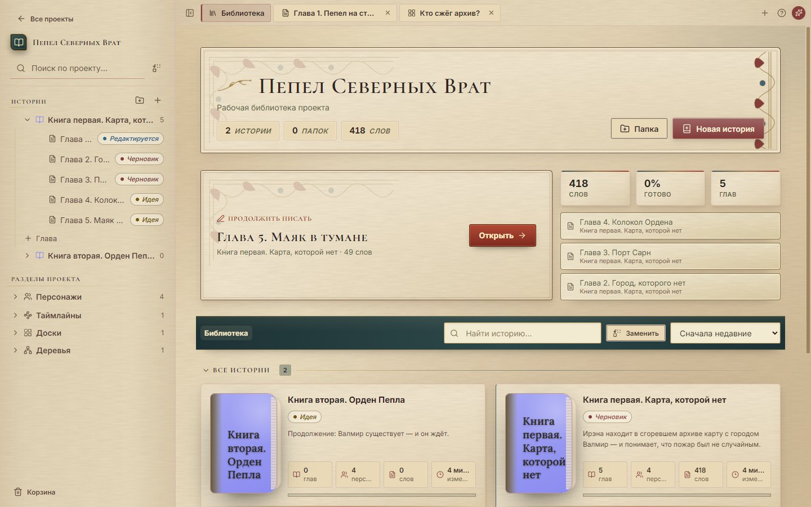
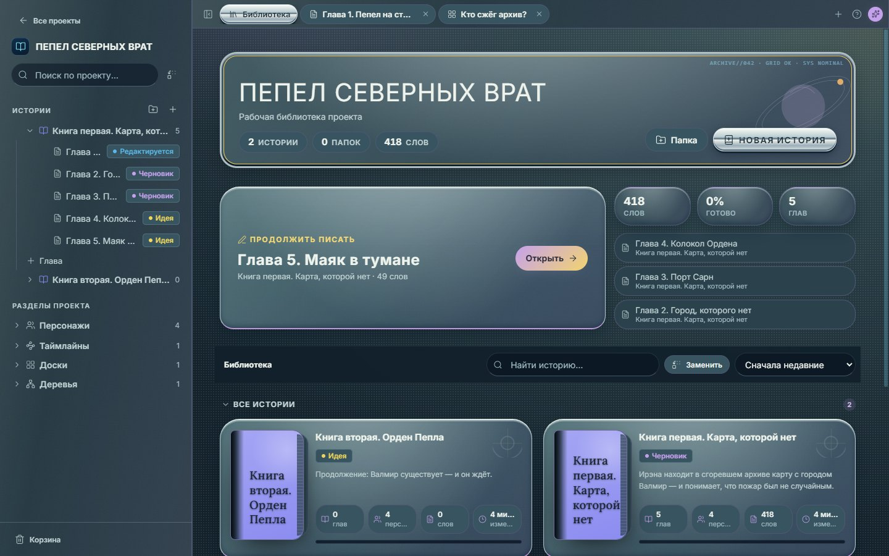
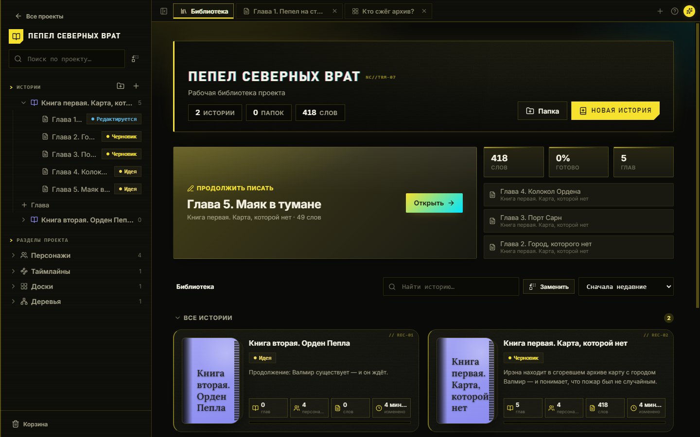
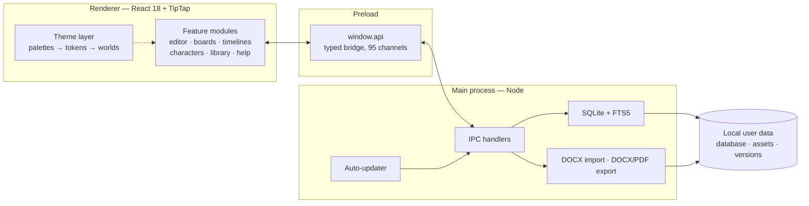

<h1 align="center">FanCreator</h1>

  <b>A local-first workspace for fiction authors</b> 
  Think <b>Word + Obsidian + Miro</b> in one offline desktop app — manuscript, linked notes and visual boards together.

  
  
  
  
  
  

  <a href="https://github.com/nazar987/FanCreator-releases/releases/latest"><b>⬇ Download for Windows</b></a>

  

---

> **Кратко по-русски.** FanCreator — local-first рабочее пространство для писателей, по сути
> Word + Obsidian + Miro в одном приложении: редактор рукописи уровня Word (страницы A4,
> таблицы, `.docx`, PDF), связанные заметки и вики-ссылки как в Obsidian, бесконечные доски
> как в Miro, плюс таймлайны, родословные и досье персонажей. Полностью офлайн, данные —
> в SQLite с полнотекстовым поиском, обновляется само. ~45 тыс. строк на TypeScript,
> 1100+ автотестов, 21 релиз за год. Этот репозиторий — публичная витрина и канал обновлений;
> исходный код — в закрытом репозитории.

---

## What it is

Writers usually juggle several tools at once: Word or Google Docs for the manuscript,
Obsidian or Notion for lore and notes, Miro for plot boards. FanCreator brings them into
**one local-first desktop app** built specifically around a novel:

| Instead of… | FanCreator gives you |
| --- | --- |
| **Word / Google Docs** | A paginated A4 manuscript editor with styles, tables, `.docx` import/export and PDF |
| **Obsidian / Notion** | Linked notes: wiki-links between chapters, characters and stories, hover previews, inline sub-pages, full-text search |
| **Miro** | Infinite boards with notes, images, shapes and bendable arrows |
| **Spreadsheets & sketches** | Timelines, fishbone diagrams, hierarchy and family trees, character dossiers |

Like Obsidian, it is fully local: no accounts, no server, no telemetry, and your data stays in
your own folder. The only network request is the update check against this repository's releases.

The app is developed together with a working author who uses it daily for real manuscripts.
Every release is driven by feedback from that use — which is why so much of the work went into
"invisible" things: Word-identical editor behaviour, safe undo paths, and never losing a chapter.

> The interface is in Russian (that is the target audience). Code and engineering docs are in English.

### At a glance

| | |
| --- | --- |
| **Codebase** | ~45 000 lines of TypeScript / TSX / CSS across 160+ modules |
| **Tests** | 1 100+ automated tests (Vitest; real SQLite, happy-dom for UI) |
| **Releases** | 21 versions since Oct 2025, delivered silently via auto-update |
| **IPC surface** | 95 typed handlers in one shared contract |
| **Editor** | TipTap 3 / ProseMirror with 14 custom extensions + real A4 pagination |
| **Themes** | 11 — six palettes and five full "theme worlds" |
| **Data safety** | trash, 20 versions per chapter, zip backups, guarded deletions |

---

## Features

### ✍️ Writing

- **Paginated A4 editor** — real pages, not a scrolling textarea: page count, page jump,
  manual page breaks, per-chapter zoom and paper tint.
- **Word-level formatting** — fonts and point sizes, line spacing, first-line indent,
  alignment, colors, highlight, resizable tables with merge/split, format painter.
- **`.docx` round-trip** — a custom OOXML importer keeps fonts, sizes, colors, spacing, indents
  and embedded images; export of a single chapter or the whole book.
- **PDF export** in book layout — A4, every chapter on a new page, images included.
- **Wiki-links** between prose, characters and chapters — hover shows a card, `Ctrl`+click jumps.
- Russian + English spellcheck, word counts, daily goals and writing sprints.

### 🗺️ Worldbuilding

  

- **Boards** — infinite canvas with notes, shapes, images and arrows that can be bent by hand
  around obstacles.
- **Timelines** — events with sub-events, plus a fishbone (Ishikawa) view.
- **Hierarchy & family trees** — zoomable, collapsible, editable in place.
- **Characters** — dossiers with avatars, tags, custom fields, art galleries and reusable templates.

### 🔎 Organization

- Browser-style tabs, `Ctrl`+`K` command palette, **full-text search** across every chapter.
- **Project-wide find & replace** with per-chapter preview — rename a character across a novel safely.
- Built-in help center, interface tour and changelog.

### 🛡️ Safety net

Fiction is irreplaceable, so destructive paths are deliberately hard to trigger:

- Automatic **chapter version history** — and a safety snapshot *before* every restore,
  so a rollback can itself be rolled back.
- **Two-level trash** for projects, stories and chapters.
- **`.fancreator` backups** — one project or all of them, with images; import never overwrites.
- Optional **auto-backup on quit**.

### 🎨 Theme worlds

Eleven themes, including five "worlds" — Fantasy, Dark Fantasy, Medieval, Sci-Fi, Cyberpunk —
that change materials, component geometry, typography and motion of the whole shell while the
manuscript page stays untouched. All textures are procedural inline SVG: zero image assets.
Each world stays usable in greyscale, at 900 px width, and with OS reduced-motion enabled.

  
   One screen, five worlds — left to right: Fantasy · Dark Fantasy · Medieval · Sci-Fi · Cyberpunk

<table>
  <tr>
    <td align="center"> Fantasy</td>
    <td align="center"> Dark Fantasy</td>
    <td align="center"> Medieval</td>
  </tr>
  <tr>
    <td align="center"> Sci-Fi</td>
    <td align="center"> Cyberpunk</td>
    <td align="center">…plus six classic color palettes</td>
  </tr>
</table>

---

## Engineering highlights

- **Secure Electron architecture.** `contextIsolation` on, `nodeIntegration` off; the renderer
  talks to Node only through a single typed IPC contract (95 channels), and images are served
  through a custom privileged `asset://` protocol instead of file paths.
- **SQLite that fails safe.** `better-sqlite3` in WAL mode with an FTS5 search index rebuilt
  transactionally on write, so it can never drift from the data. If storage can't be opened
  safely, the app starts in an explicit **read-only mode** — writes are rejected at the IPC layer
  and again in the store — instead of risking the user's files.
- **Pagination in a web editor.** ProseMirror behaves differently from Word in dozens of small
  ways writers notice instantly (lists after images, `Ctrl`+`Backspace`, indents in headings) —
  14 custom extensions close those gaps.
- **PDF without a print dialog.** Chapters are rendered to HTML in a hidden window, images are
  inlined and awaited, then `printToPDF` produces a book-formatted A4 document.
- **Design tokens, not five stylesheets.** Theme worlds declare semantic material tokens that
  feature modules consume — adding a world touches one file, not every component.
- **Safety invariants live in the data layer.** Snapshot-before-restore, snapshot-before-replace
  and soft-delete are enforced in main-process handlers, so no new UI path can bypass them.
- **Test-backed refactoring.** 1 100+ characterization and unit tests run against real SQL,
  guarding the data format before any migration.

### Architecture

### Delivery pipeline

Pushing a version tag runs GitHub Actions on Windows: native modules are rebuilt for Electron,
the app is bundled with electron-vite, and electron-builder publishes the NSIS installer and
update manifest **to this repository**. Installed copies download the update in the background
and apply it on quit. CI verifies the token, the repository visibility and the version before
building, and fails early with a clear message otherwise.

## Tech stack

| Layer | Tools |
| --- | --- |
| Desktop shell | Electron 34, electron-vite, electron-builder (NSIS) |
| UI | React 18, TypeScript 5.7, framer-motion, lucide-react, @hello-pangea/dnd |
| Editor | TipTap 3 / ProseMirror, tiptap-pagination-plus, 14 custom extensions |
| Storage | better-sqlite3 (WAL, FTS5), electron-store |
| Documents | custom OOXML parser, mammoth, docx / html-to-docx, `printToPDF`, JSZip |
| Quality | Vitest, happy-dom, strict TypeScript, CI typecheck + tests |
| Delivery | GitHub Actions → GitHub Releases → electron-updater |

## How it is built

- Work is planned in numbered phases from real-usage feedback; every phase ends in a release.
- Architectural decisions are recorded as **ADRs**, and risky ideas are validated with
  throwaway **spikes** before they touch the codebase.
- Changes go through review — including dedicated security reviews with written verdicts
  for each finding.
- A task log keeps the reasoning behind every decision, including rejected proposals
  and lessons from bugs that slipped through.

## Roadmap

Currently in design and prototyping: an **Android companion app**. The plan is one shared
TypeScript core running in both Electron and a Capacitor WebView, SQLite on both platforms,
and state-based sync (LAN, cloud drives, or a file) with **end-to-end encryption** and
conflict copies so that chapter text is never silently overwritten.

---

## Download

Grab the latest installer from **[Releases](https://github.com/nazar987/FanCreator-releases/releases/latest)**
(`FanCreator-Setup-x.y.z.exe`). Windows 10/11, x64. After installation the app keeps itself up to date.

> The installer is not code-signed, so Windows SmartScreen may show a warning on first run:
> *More info → Run anyway*.

## About this repository

This public repository is the **distribution channel**: it holds release builds and the
update manifest that installed copies check. The source code lives in a private repository —
a code walkthrough is available on request.

## License

[MIT](LICENSE)
