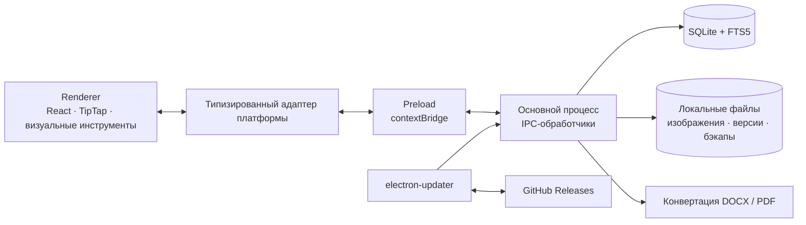

<h1 align="center">FanCreator</h1>

  <b>Рабочее пространство для написания историй и создания вымышленных миров</b> 
  Рукопись, персонажи, связанные заметки и визуальное планирование в одном офлайн-приложении.

  <a href="README.md">English</a> · <b>Русский</b>

  
  
  
  
  

  <a href="https://github.com/nazar987/FanCreator-releases/releases/latest"><b>Скачать для Windows</b></a>

  

## О проекте

FanCreator объединяет рукопись и материалы к ней в одном проекте. Главы, досье персонажей,
сюжетные доски, таймлайны и родословные хранятся вместе, а внутренние ссылки связывают
текст с элементами вымышленного мира.

Приложение для Windows работает офлайн и не требует регистрации. Данные проектов
и изображения хранятся локально; для написания и редактирования не нужен сервер.
Обновления распространяются через GitHub Releases. Интерфейс приложения — на русском языке.

Развитие проекта опирается на обратную связь от писательницы, которая использует
приложение в повседневной работе над рукописями.

## Возможности

| Раздел | Что доступно |
| --- | --- |
| **Редактор рукописи** | Страницы A4, разрывы страниц, шрифты, стили абзацев, интервалы, отступы, таблицы, изображения и копирование форматирования |
| **Обмен документами** | Импорт и экспорт DOCX; экспорт отдельной главы или всей истории в PDF |
| **Связанные материалы** | Вики-ссылки на персонажей, истории и главы, карточки при наведении и создание вложенных страниц из текста |
| **Визуальное планирование** | Бесконечные доски с заметками, изображениями, фигурами и настраиваемыми стрелками; таймлайны с подсобытиями и диаграммой Исикавы |
| **Мир истории** | Досье персонажей, произвольные поля, повторно используемые шаблоны, галереи, деревья иерархий и родословные |
| **Навигация и поиск** | Вкладки, палитра команд, полнотекстовый поиск SQLite FTS5 и замена по проекту с предварительным просмотром по главам |
| **Работа над текстом** | Проверка орфографии на русском и английском, подсчёт слов, дневная цель и писательские спринты |

  

### Защита данных

- Автоматическая история хранит до 20 версий каждой главы. Перед восстановлением
  приложение сохраняет снимок текущего текста.
- Проекты, истории и главы сначала попадают в корзину, откуда их можно восстановить.
  Окончательное удаление выполняется отдельно.
- Архивы `.fancreator` содержат данные проекта и изображения. При импорте создаются
  новые идентификаторы, чтобы не перезаписать существующий проект.
- Можно включить резервное копирование при выходе. Перед закрытием приложения
  или установкой обновления завершаются отложенные сохранения.
- Если хранилище нельзя безопасно открыть, приложение переходит в явный режим
  «только чтение». Запись блокируется на уровне IPC и функций хранилища;
  доступные данные можно экспортировать во внешнюю папку.

### Темы оформления

В приложении 11 тем: шесть цветовых палитр и пять визуальных миров — Fantasy,
Dark Fantasy, Medieval, Sci-Fi и Cyberpunk. Миры меняют материалы, типографику,
геометрию компонентов и анимацию, сохраняя оформление страниц рукописи.
Система построена на семантических дизайн-токенах и процедурных SVG-текстурах,
учитывает системное ограничение анимаций и поддерживает спокойный режим оформления.

  

## Архитектура

Интерфейс на React, preload-мост и основной процесс Electron разделены.
Renderer обращается к возможностям десктопа через типизированный адаптер платформы;
работа с файлами, хранилищем, конвертацией документов и обновлениями выполняется
в основном процессе.

### Инженерные решения

- **Типизированные границы процессов.** Общий API-контракт и реестр каналов связывают
  main и preload. Каналы классифицированы по влиянию на данные, поэтому ограничения
  режима «только чтение» применяются централизованно. Архитектурные тесты проверяют
  соответствие каналов и границы импортов. В renderer включён `contextIsolation`
  и отключён `nodeIntegration`; изображения проектов доступны через протокол `asset://`.
- **Локальное хранилище с транзакциями.** SQLite работает в режиме WAL.
  Запись проекта и обновление индекса FTS5 выполняются в одной транзакции,
  чтобы поиск соответствовал сохранённому тексту. При запуске проверяется
  совместимость формата данных до разрешения записи.
- **Постраничный веб-редактор.** TipTap и ProseMirror дополнены расширениями
  для работы с рукописью: отступами абзацев, размерами изображений,
  разрывами страниц, внутренними ссылками и обработкой клавиатурных команд.
- **Конвертация документов.** Импорт DOCX разбирает форматирование OOXML
  и встроенные изображения; предусмотрен резервный путь через mammoth.
  Для PDF главы рендерятся в скрытом окне Electron, приложение дожидается
  декодирования изображений и вызывает `printToPDF` с форматом A4.
- **Восстановление на уровне данных.** Обработчики основного процесса создают
  снимки перед восстановлением и массовой заменой. Изменения текста вне редактора
  передаются открытым главам, чтобы последующее автосохранение не затёрло новый текст.

## Стек и проверка качества

| Слой | Технологии |
| --- | --- |
| Десктоп | Electron 34, electron-vite, electron-builder, установщик Windows NSIS |
| Интерфейс | React 18, TypeScript 5.7, Framer Motion, Lucide, @hello-pangea/dnd |
| Редактор | TipTap 3, ProseMirror, tiptap-pagination-plus, собственные расширения |
| Хранилище | better-sqlite3, SQLite WAL и FTS5, electron-store |
| Документы и бэкапы | Парсер OOXML, mammoth, docx, html-to-docx, JSZip, Electron printToPDF |
| Проверки | Vitest, happy-dom, проверка типов TypeScript, архитектурные тесты |
| Доставка | GitHub Actions, GitHub Releases, electron-updater |

Тесты основного процесса выполняют настоящие SQL-запросы через адаптер `node:sqlite`,
повторяющий API `better-sqlite3`. Отдельные наборы проверяют сбои хранилища,
режим «только чтение», резервное копирование и восстановление, конвертацию документов,
поведение редактора и границы архитектуры. Перед упаковкой релиза CI запускает
проверку типов и автоматические тесты.

Тег версии запускает сборку на Windows: проверку версии и репозитория релизов,
пересборку нативных зависимостей под Electron, проверки, упаковку приложения
и публикацию установщика с манифестом обновления. Установленное приложение
загружает обновления в фоне и может применить их при выходе или по команде пользователя.

## Скачивание и установка

1. Откройте [последний релиз](https://github.com/nazar987/FanCreator-releases/releases/latest).
2. Скачайте `FanCreator-Setup-x.y.z.exe` и запустите установщик.
3. Откройте FanCreator и создайте проект.

Опубликованная сборка предназначена для Windows 10/11, x64. Установщик пока
не подписан сертификатом, поэтому Windows SmartScreen может показать предупреждение.
Дальнейшие обновления устанавливаются через приложение.

## Направление развития

Android-компаньон находится на этапе проработки архитектуры и отдельных прототипов:
общее ядро на TypeScript, оболочка Capacitor и синхронизация между устройствами.
Эти возможности разрабатываются и не входят в текущий Windows-релиз.

## Об этом репозитории

Публичный репозиторий содержит описание проекта, скриншоты, установщики и метаданные
обновлений. Исходный код приложения находится в закрытом репозитории.

## Лицензия

[MIT](https://github.com/nazar987/FanCreator-releases/blob/main/LICENSE)
